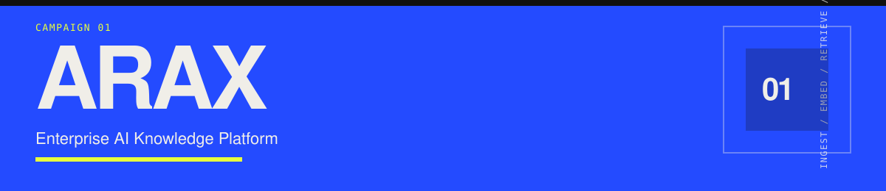
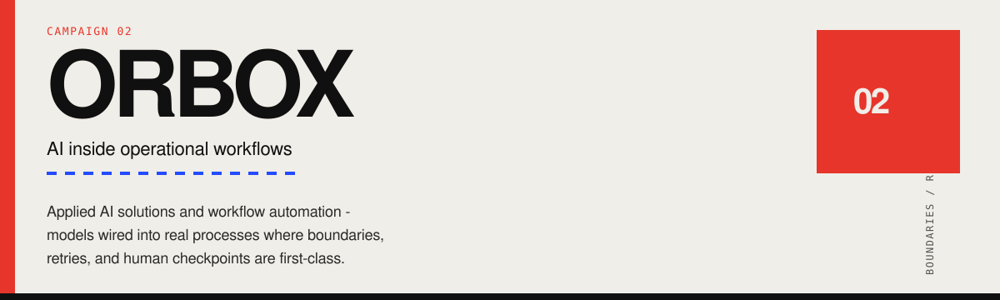

 

  <a href="https://akruel1.github.io/Akruel1/"><strong>Portfolio</strong></a>
  ·
  <a href="https://www.linkedin.com/in/%D0%B0%D0%BD%D0%B4%D1%80%D0%B5%D0%B9-%D1%82%D0%B5%D1%81%D1%81%D0%B0-65993738b/">LinkedIn</a>
  ·
  <a href="https://t.me/Akruel1">Telegram</a>
  ·
  <a href="mailto:tecca5864@gmail.com">Email</a>

 

 

## Selected work

Two campaigns. Architecture without the SaaS costume.

 

A platform concept for enterprise knowledge — ingest, embed, retrieve, and answer through controlled surfaces. Designed as infrastructure, not a chatbot wrapper.

 

Applied AI solutions and workflow automation — models wired into real processes where boundaries, retries, and human checkpoints are first-class.

 

## Focus

| | |
| :--- | :--- |
| **Systems thinking** | Start from data flow and ownership — not from model demos. |
| **Practical AI** | Intelligence only where it reduces real operational work. |
| **Clean architecture** | Clear contracts, failure modes, and deployable shapes. |

 

  ANDREY TESSA · АНДРЕЙ ТЕССА · AI SYSTEMS ENGINEER 
  <a href="https://akruel1.github.io/Akruel1/">akruel1.github.io/Akruel1</a>

<!-- Portfolio site build docs: see PORTFOLIO.md -->
